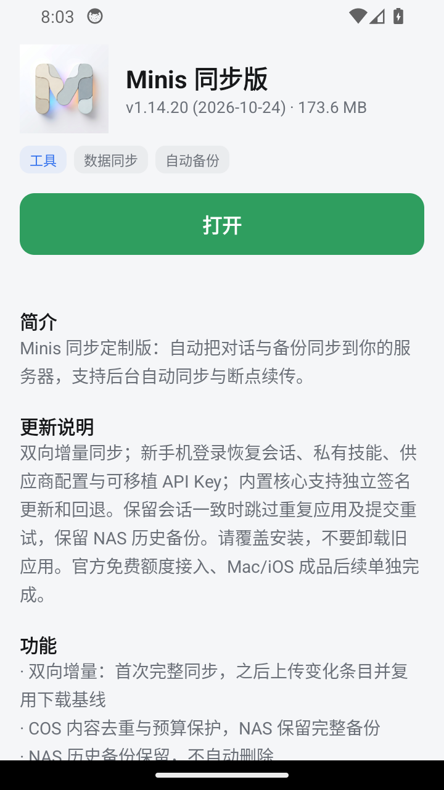

# 3.0.1 / 9 验收记录

这是撤回9的历史记录；当前本地修复进度及约束以[3.0.2记录](RELEASE-3.0.2.md)为准，本轮不向VirusTotal上传样本、不向Google提交申诉。

状态：候选已构建并完成隔离设备验证，实体安装被Google Play保护机制拦截；已撤回稳定目录更新，待验收。未关闭或绕过系统保护，实体设备继续保留原2.1.0/7及其数据。

## 变更与产物

Android 11及以上会过滤应用查询。此前缺少queries声明，并缓存完整安装列表，导致已安装应用误显示“安装”。本候选声明可启动应用的查询范围，按目录包名直接读取PackageInfo，避免全局和负缓存导致安装后状态滞后。[Android官方说明](https://developer.android.com/training/package-visibility/declaring)。

- 包名：`site.zhangyue.store`；版本3.0.1/9，minSdk24。
- 大小119,617字节；SHA-256：`a0ea19473c8439c3dc1b3bd6f102d621ec80fc69a5be4f1bff2a5882959242b9`。
- 证书SHA-256：`61d8245fd71fb613cd3ff6556dc4a0d68eed31f21f53bb8109e510120632b6bc`，与实际旧7、已发8相同。
- 已发布8的真实摘要为`6cc38bb97edcd815a356f452e290c75be449164068af2e343323c015cc098d04`。同版本的其他构建文件不能替代此基线。
- 正式Minis安装包、账号和数据不属于本次商店代码修改范围。

## 已有证据与未通过项

| 项目 | 结果 |
| --- | --- |
| 构建、APK身份、签名、递增版本 | 通过；同签名的新候选 |
| 状态矩阵 | 自建Android14（API34）验证未安装、旧版可更新、当前版本打开、较新版不降级及实际版本号 |
| 安装期间缓存 | 同一进程先观察夹具1，再经系统安装夹具2，不重启进程即可识别新版本，通过 |
| 实际界面 | 自建设备真实Minis121列表显示“已安装”，详情显示“打开” |
| 覆盖安装 | 自建设备8经ADB覆盖9通过；与真实应用内OTA分开记录 |
| 目录、页面、完整公网下载 | 发布时对应同一SHA；其他应用条目保留；随后因实体安装失败撤回稳定指针 |
| 实体7→9应用内OTA | 旧客户端实际发现并下载9，系统安装阶段Play保护扫描后判定“可能有害”并拦截；未通过，设备仍7。原数据已先备份，安装尝试后原备份范围文件摘要均不变 |
| 旧8→9应用内OTA | 未通过：实际已发8的Manifest没有Installer所需ApkProvider，日志报Failed to find provider info，系统安装器不能读取其content URI。候选9包含Provider，但不能反向修复旧包；不改写已发8，不以ADB覆盖冒充OTA |
| 旧8→9数据marker | 仅已在旧8写入本轮合成marker；OTA未完成，未宣称marker升级读回通过 |
| 平台范围 | 实测Android14（API34）隔离环境，实体Android12安装被拦截；API24–27未实测 |
| 模型审阅 | 指定DeepSeek接口不可用，未完成 |

## 回退与下一步

稳定apps.json目标条目及self已恢复8，旧store.json恢复其原7；持锁合并回退，其他应用条目保留。候选9的不可变APK、校验值和发布证据保留，下载页明确待验收；没有降级或清理用户设备。候选后续若改变内容必须递增版本，不能覆盖9。

下一步先核实Play保护拦截原因及候选安全性，使用官方审查途径处理；未具备实体安装证据前不重新上架稳定目录。旧8的原生安装入口缺陷需要独立兼容升级方案并真实验证，不声称已修复旧客户端。源码修复可以评审，不代表候选发布验收已通过。

## 重跑状态测试与只读备份

`tests/build_probe.py`读取被忽略的本地构建配置，生成同签名的状态probe、版本1/2夹具及只读备份probe。不要把部署配置或签名凭据提交Git。InstalledStateProbe的transition模式须在自建模拟器运行；它等待夹具从1覆盖2后读回实际状态。seedMarker/verifyMarker仅允许ranchu，真实用户设备不得用于夹具安装。

ReadOnlyDataProbe跳过Application初始化，不启动商店网络逻辑，不恢复文件；复制私有数据（排除cache/code_cache/lib）和外部store.properties到新的快照目录，逐文件核对原文件前后及副本摘要。必须先在自建设备测试，再用于用户明确授权的设备。运行instrumentation会结束目标进程，不在有活动任务时使用。快照可能含私有配置和WebView数据，只保存到受保护目录，不上传Git、发行包或模型审阅。
