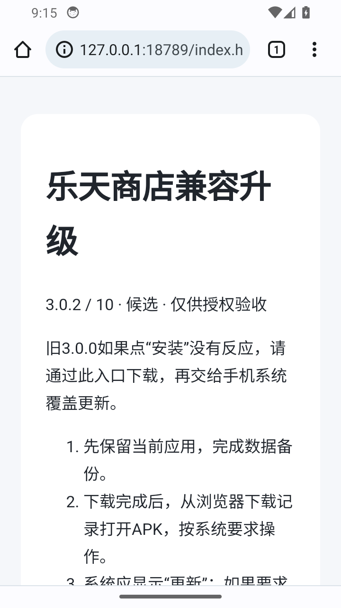

# 3.0.2 / 10 本地兼容修复候选

状态：代码与隔离验证已完成一轮；真机安装未通过，未发布稳定版本、未合并PR。本轮只维护自建商店，不向VirusTotal上传样本，不向Google提交申诉；正常系统安装扫描保持开启。现有手机仍使用2.1.0/7，原数据已先备份，安装尝试后备份范围文件摘要不变。

## 修复范围

已发布3.0.0/8缺少原生安装流程需要的ApkProvider，不能通过服务端清单给已安装的旧APK补入组件。它已有的详情“网页版”链接可以提供兼容迁移路径：详情→网页版→浏览器下载→系统覆盖更新，保留旧应用和数据。这条路径仍保留手机的安装检查；不是关闭保护或更换包名绕过拦截。

`tools/build_compat_page.py`生成该页面，正式输入要求同一批准HTTPS来源、相同商店包名、更高版本和有效SHA256/大小。页面要求先备份，系统应显示“更新”；若要求卸载或安全扫描阻止安装则停止。测试使用本机回环服务和内存合成目录，未修改公网目录，尚未给稳定条目增加web入口。只有真机验收通过后才接入正式目录和发布新包。

新版原生安装使用[Android PackageInstaller会话](https://developer.android.com/reference/android/content/pm/PackageInstaller)，不再依赖Provider唤起安装：

- 安装前核对缓存路径、包名、递增版本、大小、相同签名或兼容签名历史。
- 写入系统会话时重新计算完整SHA256；摘要不符则放弃会话。
- 系统用户确认保持必需，不申请静默更新或绕过验证。
- 随机会话凭据、显式不导出接收器绑定系统结果；只有系统成功且已装版本匹配才记“已安装”。取消、拦截和失败不会记成功；自更新后结果可持久读取。
- 每次重新读取实际已装版本。旧缓存只有与当前目录SHA/大小及完成回执相符才显示可安装；下载文件就位后才写完成回执。
- 文件读取使用兼容API24的流，避免依赖API26才有的Files接口；构建错误正常输出，签名密码改由环境参数传递。

## 候选身份与证据边界

所有本轮候选均只私有暂存，没有改写已发布的8或9。

| 私有候选 | APK SHA-256 | 证据 |
| --- | --- | --- |
| 安装会话初版 | `86fccb82e94529f7e9d6b02315569acd0c5c3e1affed75116469a5cc362fda1f` | 隔离验证安装负向、取消/成功、跨进程结果保存 |
| 缓存回执修订 | `c3d029260c305c230b83d7548f05ebb5d91a06792dc9185208756601cde43870` | 实际旧8的网页版入口→Chrome正常下载→系统覆盖10；原数据marker保留。真机经正常扫描后被Play保护拦截，仍保留旧7 |
| 最新API24兼容修订 | `ffa9a190efad893383a135c85610c6f1fb1b0c97212b64a49b64ddc32b1dc4e1` | 123,713字节；编译、隔离覆盖marker、缓存匹配/过期/缺失回执/大小不符、同代码自更新和重启后结果/marker读回通过。真机系统安装未完成，未取得成功证据，不记通过 |

包名`site.zhangyue.store`；版本3.0.2/10，minSdk24/targetSdk35。证书SHA-256 `61d8245fd71fb613cd3ff6556dc4a0d68eed31f21f53bb8109e510120632b6bc`，与真实旧7及已发8相同。签名、标准ZIP头、无重复条目检查通过，没有打包签名钥匙、部署properties或用户数据。APK只声明网络、网络状态、用户请求安装和下载通知权限。

隔离自更新使用额外的私有11号夹具，其生产classes.dex与最新10完全一致，只为验证商店更新自己后的安装结果与旧marker保留；它没有作为版本3.0.3发布或安装到用户手机。不同候选的旧证据不冒充最新整包的真机验收。

## 实测与剩余

| 项目 | 结果 |
| --- | --- |
| 包/版本/大小/错误签名拒绝 | Android14隔离环境通过 |
| 摘要篡改 | 系统会话提交前拒绝，原夹具版本保留，通过 |
| 系统取消与安装成功 | 实际系统界面操作，结果与实际版本核对，通过 |
| 自更新结果和旧数据 | 同一生产代码的私有10→11系统自更新，重启探针后核对目标包/版本、持久结果和原marker，通过 |
| 原生状态/旧下载缓存 | 已安装状态、过期SHA、缺回执、大小不符处理通过 |
| 旧8兼容外链 | 实际旧8只在内存提供合成目录，点击现有网页版按钮，经回环测试页/Chrome/系统更新完成候选10；旧marker保留。不是旧8原生安装按钮已修，也不是正式HTTPS目录上线验收 |
| 真机 | 先备份，正常Chrome下载并设备端核对摘要；此前候选被系统保护扫描阻止，最新候选也没有安装成功。手机保持旧7，原数据未变；不记通过 |
| 稳定发布/合并 | 未进行，PR保留草稿 |
| API24–27实体、指定模型审阅 | 未验证/未完成 |

## 接手与复验

`tests/build_probe.py`构建同签名维护探针与隔离夹具；部署配置和临时测试签名钥匙均被忽略，不进入Git。InstallerProbe和LegacyLinkProbe只允许ranchu自建设备，不能对真实用户设备注入目录或夹具。

LegacyLinkProbe要求真实版本8，仅将合成目录放入内存后打开既有详情页；它不写正式目录或业务文件。浏览器流程需人工确认系统来源授权、下载、安装；不能用ADB覆盖安装代替这个兼容入口结果。

InstallerProbe要求独立夹具基线，分别运行validation/tamper/cancel/success；self要求私有10基线，用11号同代码夹具验证更新。系统可能保留或替换测试进程，不能单凭“进程退出”判成功；verifySelf必须再次启动，核对实际版本、对应自更新会话和旧marker。

继续保留现用本地商店、只读备份与候选审计资料。真机成功安装、数据保留与入口验收完成前，不更新稳定清单、不上传正式发行目录、不合并草稿。不改签名或包名躲检测，不关闭安装保护。失败的系统安装不能被隔离设备通过或源码编译替代。
